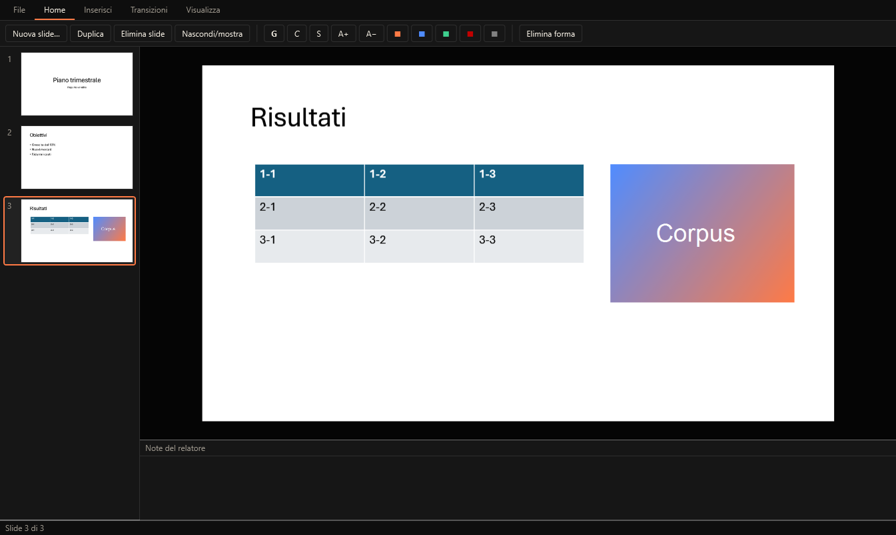
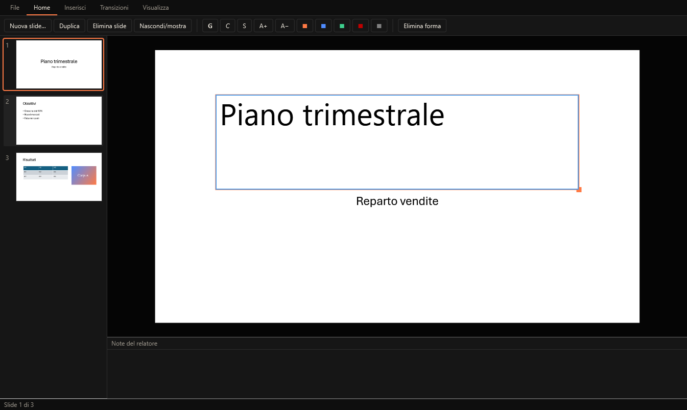
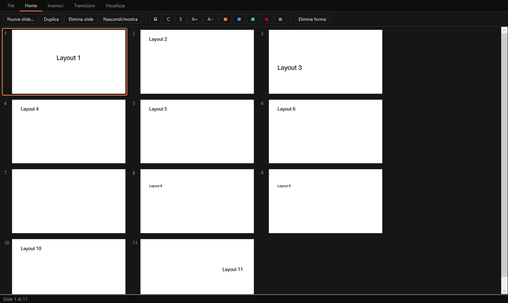
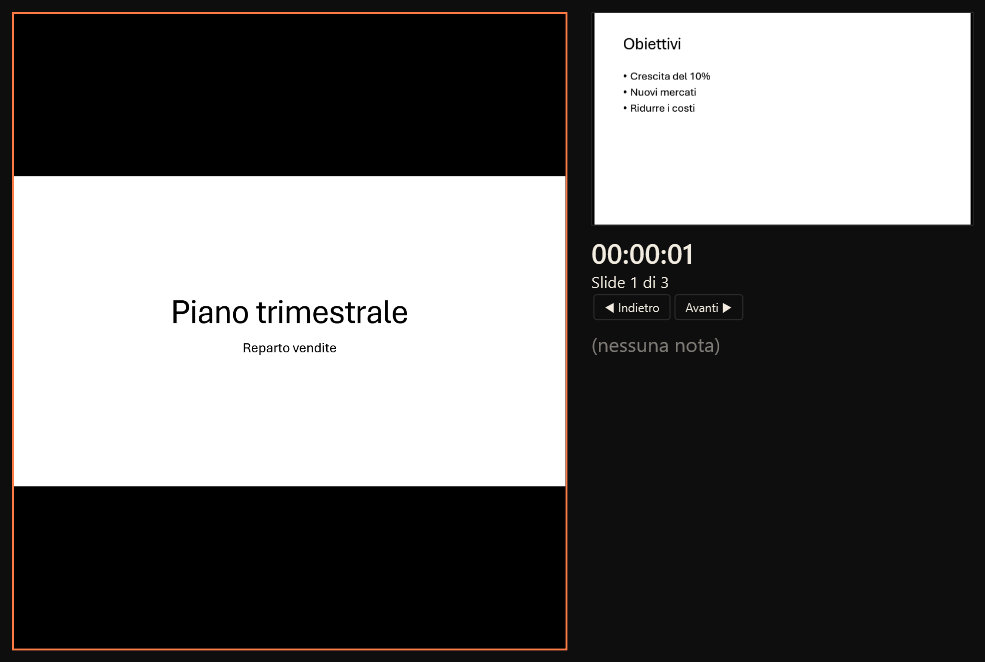
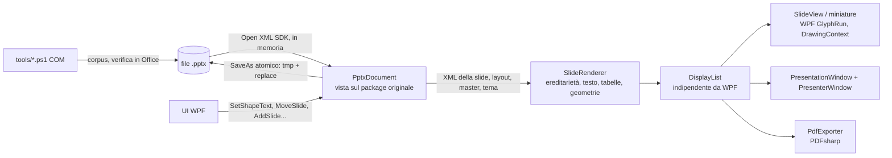

# PowerPresentations

Editor di presentazioni per Windows 10/11 (x64), clone aperto di PowerPoint scritto in C# / .NET 10 / WPF. Il formato nativo è `.pptx` (ECMA-376):
un file creato da PowerPoint si apre e si vede come in PowerPoint; un file salvato da PowerPresentations si apre in PowerPoint **senza** "contenuto
illeggibile / ripristino" e con lo stesso aspetto. Tema scuro predefinito (accento `#ff7a45`), tema chiaro commutabile.

Licenza MIT. Nomi, icona e grafica sono originali; nessuna risorsa Microsoft nel repository (vedi `THIRD_PARTY.md`).



| Modifica del testo | Sequenza diapositive | Vista relatore |
|---|---|---|
|  |  |  |

Presentazione a schermo intero (cattura della finestra reale, 1920×1080): `docs/app-schermo-intero-reale-2.png`. Tema chiaro: `docs/app-light.png`.

## Cosa fa (P0 completato)

- Slide basate su **master e layout**, **temi** (colori e font) letti dal file, ereditarietà slide → layout → master → tema.
- Caselle di testo, forme base, immagini, tabelle (inserimento, rendering, spostamento/ridimensionamento).
- Vista a **miniature**, **riordino** con drag & drop (tocca solo `sldIdLst`), **note del relatore**.
- **Presentazione a schermo intero** con **vista relatore** (corrente, successiva, note, timer).
- **Transizioni** base (dissolvenza, spingi, cancella, copri, scopri) ed **esportazione PDF**.

Stato dettagliato e cosa manca: [`FEATURES.md`](FEATURES.md). Compatibilità, numeri e differenze visive reali: [`COMPAT.md`](COMPAT.md).

## Compilare e avviare

```powershell
dotnet build                       # soluzione: Core, App, Tests
dotnet test                        # 225 test; quelli OfficeCom aprono il vero PowerPoint (solo PID avviati dai test)
dotnet test --filter "Category!=OfficeCom&Category!=Ui"   # solo test puri (nessun Office, nessun mouse)
dotnet run --project src/PowerPresentations.App -- percorso\file.pptx
```

Requisiti: Windows 10/11 x64, .NET SDK 10.0.403 (`global.json`). I test `OfficeCom` richiedono PowerPoint installato; i test `Ui` pilotano la
finestra reale con UI Automation e **muovono il mouse** per ~20 s.

Riga di comando dell'app (usata dai test e dagli script): `--render-png <pptx> <cartella> [larghezza]`, `--export-pdf <pptx> <pdf>`,
`<pptx> --screenshot <png> [main|edit|light|present|sorter|slideN]`.

Strumenti in `tools/` (PowerShell 5.1 + COM): `make-corpus.ps1` (rigenera il corpus con PowerPoint), `office-inspect.ps1` (apre i file in Office e
scrive JSON), `watchdog.ps1`/`Common.ps1` (isolamento per PID), `visual-compare.ps1` + `PdfRaster` (confronto PDF), `ribbon-inventory.ps1`,
`ui-smoke.ps1`, `screenshot.ps1`, `make-icon.ps1`.

## Architettura



- `src/PowerPresentations.Core` — nessuna dipendenza da WPF: `PptxDocument` (apertura, salvataggio atomico, modifiche), `Rendering/` (renderer slide, tema/colori,
  geometrie, impaginazione del testo con metriche TrueType lette dal file del font, display list), `PdfExporter`.
- `src/PowerPresentations.App` — WPF: finestra principale, `SlideView`, presentazione e vista relatore, tema scuro/chiaro.
- `tests/PowerPresentations.Tests` — xUnit: round-trip su tutto il corpus, renderer, modifiche, PDF, COM (`OfficeCom`) e UI reale (`Ui`).

**Round-trip**: il documento tiene aperto il package originale; il modello è una vista sugli elementi XML. Il salvataggio riscrive solo le part toccate
(l'SDK ricopia le altre) e sostituisce il file in modo atomico. Il renderer legge l'XML senza forzare il caricamento del DOM delle part non toccate.

## Test e stato

Vedi il blocco "Esito" in fondo a questo file, aggiornato a ogni consegna.

## Limiti principali

Niente annulla/ripristina, niente editor di master/layout, animazioni degli oggetti conservate ma non riprodotte, grafici/SmartArt solo segnaposto,
nessun supporto a più monitor verificato. Elenco completo in `FEATURES.md` e `COMPAT.md`.

## Esito (ultima esecuzione)

```
dotnet build  → Compilazione completata. Avvisi: 0  Errori: 0
dotnet test   → Superato! Non superati: 0. Superati: 225. Ignorati: 0. Totale: 225. Durata: 1 m 29 s
```

Corpus: 35 file dal vero PowerPoint, 35/35 (100%) si riaprono in Office dopo il round-trip del clone con contenuto identico; il controllo negativo
(XML rotto, part mancante, attributo invalido) viene colto dal rilevatore.
